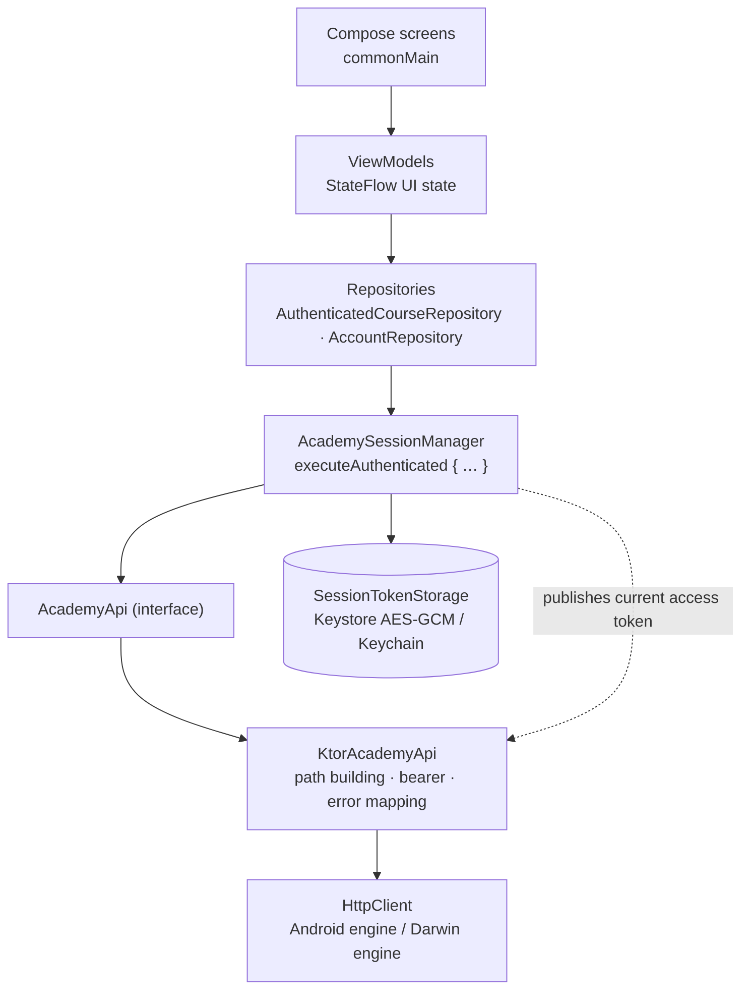
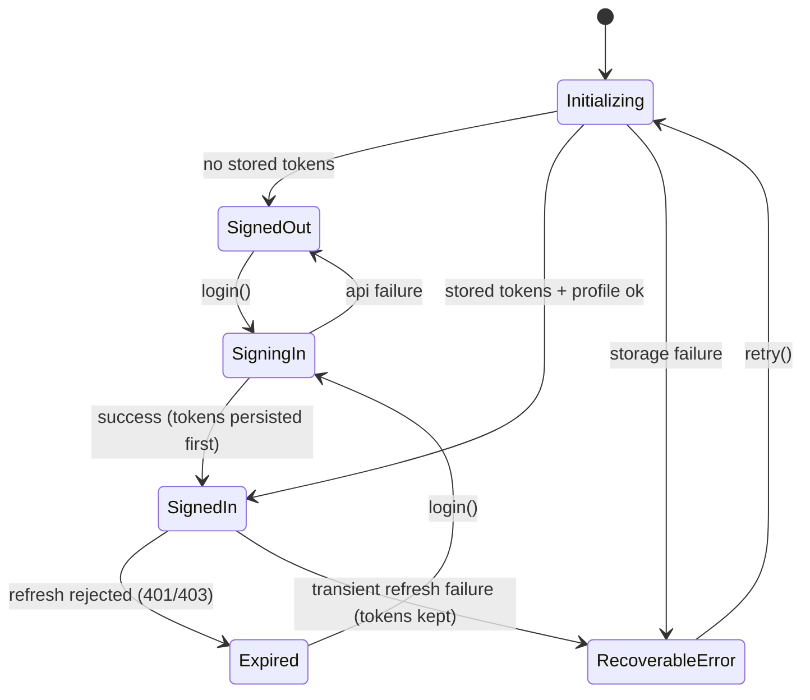

# Architecture

This document describes the client architecture of Academy Client. The server side (a WordPress plugin exposing the REST API) is intentionally out of scope.

## Layering

Rules:

1. Portable logic lives in `shared/src/commonMain`. `androidMain`/`iosMain` contain only platform implementations (Keystore, Keychain, HTTP engines, WebView actuals).
2. UI code talks to view models, never to Ktor.
3. Every authenticated operation runs through `AcademySessionManager.executeAuthenticated`, which owns refresh-and-retry. The API layer additionally guards against a missing token before sending a request.
4. WordPress IDs are Kotlin `Long`. Protocol values and server-authored content are preserved as-is.

## Module map

| Area | Package | Responsibility |
| --- | --- | --- |
| API contract | `api` | `AcademyApi` interface, `KtorAcademyApi`, `ApiResult`/`AcademyApiError`, environment selection |
| Models | `api.model` | Serializable DTOs for the frozen API contract |
| Networking | `network` | HTTP client factory, JSON config, timeouts, opt-in sanitized logging |
| Session | `session` | State machine, single-flight refresh, token storage contract |
| Course | `course` | Course/curriculum/lesson/playback/quiz view models, screens, URL policies |
| Account | `features.account` | Profile editing, avatar, deletion request |
| Auth | `features.auth` | Sign-in / register / password-reset presentation |
| Design | `design` | Tokens, typography, theme, adaptive scaffold, shared state views |
| Navigation | `navigation` | Root destinations, shell state, window-class breakpoints; Learning child stack on Navigation 3 (`course.navigation`) |

## Session lifecycle

Key properties (all covered by tests):

- **Single-flight refresh.** Concurrent 401s share one in-flight refresh via a `CompletableDeferred`; a 12-way fan-out performs exactly one `auth/refresh` call.
- **Durable before publish.** On rotation, the replacement token pair is written to secure storage *before* the new access token is published to the request layer, so no request can observe an unpersisted token.
- **One retry.** A failed authenticated request is retried once after a successful refresh; a second `401` expires the session.
- **Logout wins races.** A refresh completing after logout re-checks the current token and discards its result instead of resurrecting the session.

## Transport and error model

- `expectSuccess = false` — non-2xx responses reach the typed mapper instead of throwing.
- Sealed result types: `ApiResult<T>` = `Success` | `Failure(AcademyApiError)`.
- `AcademyApiError` covers missing token, storage failure, timeout, no connection, invalid response, HTTP status families (400/401/403/404/409/410/429/5xx), and unexpected failures; the UI maps every variant to a localized message.
- JSON: `ignoreUnknownKeys = true` (forward-compatible contract), strict parsing otherwise.
- Logging is opt-in and header-only with the `Authorization` header sanitized; disabled by default.

## Platform boundaries (`expect`/`actual`)

| Boundary | Purpose |
| --- | --- |
| `createPlatformHttpClient` | Android engine vs. Darwin engine |
| `PlatformBackHandler` | Android back handler; no-op on iOS |
| `BunnyEmbedPlayer` | Hardened `WebView` vs. `WKWebView` video surface with URL allowlisting |
| `AcademyQuizWebView` | Quiz surface: form-POST launch into an isolated browsing session |
| `platformLocalApiBaseUrl` | Emulator loopback (`10.0.2.2`) vs. simulator loopback (`127.0.0.1`) |

Both WebViews validate every main-frame navigation against the authorized URL and release all playback resources when the screen closes.

## Security notes

- Tokens are stored only through `SessionTokenStorage` implementations backed by Android Keystore (AES-GCM, non-exportable key) and iOS Keychain (`AfterFirstUnlockThisDeviceOnly`).
- The token pair is persisted as a single serialized value, so rotation can never leave a mixed pair behind.
- Quiz browsing data lives in an isolated store (Android WebView profile / `WKWebsiteDataStore.nonPersistent`) and is wiped by an explicit logout call on exit.
- Production API configuration is structurally disabled (`baseUrl = null`) until a reviewed configuration is added.
- `scripts/agent-check.sh` scans every commit for credential patterns.

## Testing strategy

| Source set | Focus |
| --- | --- |
| `commonTest` (150) | API contract via `MockEngine`, session concurrency, view-model behavior, Navigation 3 route serialization and restoration, URL policies, design tokens |
| `androidHostTest` (5) | Environment selection, opt-in live integration flow |
| `androidDeviceTest` (6) | Keystore round-trip, WebView profile isolation |
| `iosTest` (3) | Keychain round-trip, environment selection (macOS) |
| `androidApp` instrumentation (4) | Fullscreen video host behavior |

The live integration test is opt-in (`ACADEMY_LIVE_TEST=1`) and reads credentials from environment variables only.

## Deliberate exclusions

- **No navigation library for the root shell.** Home, My Learning, and Profile tabs stay hand-rolled. The Learning child stack (Dashboard → Courses → Curriculum → Lesson → Quiz) runs on **Navigation 3**: serializable `NavKey` routes with only stable IDs, explicit polymorphic serializers (identical on Android and iOS), validated history restoration, and quiz routes discarded on process death so an interrupted WebView session can never resume unattended.
- **No offline downloads.** Deferred until media-delivery and platform protection requirements are settled.
- **No server code.** Entitlement rules, profile storage, and media authorization belong to the API plugin, not to this client.
