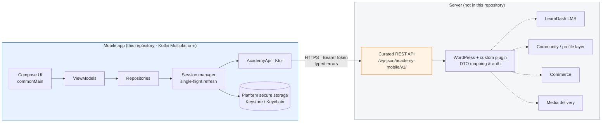
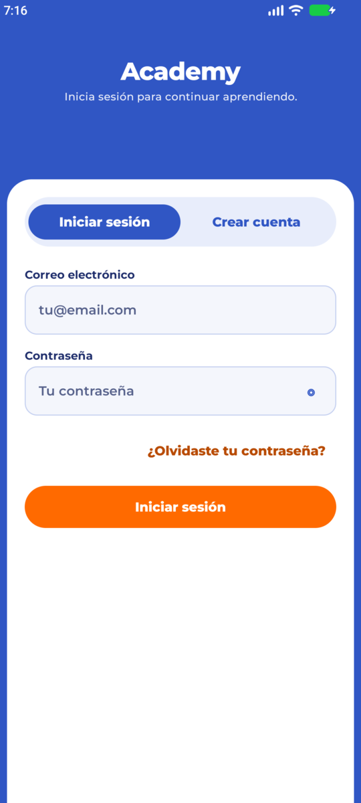
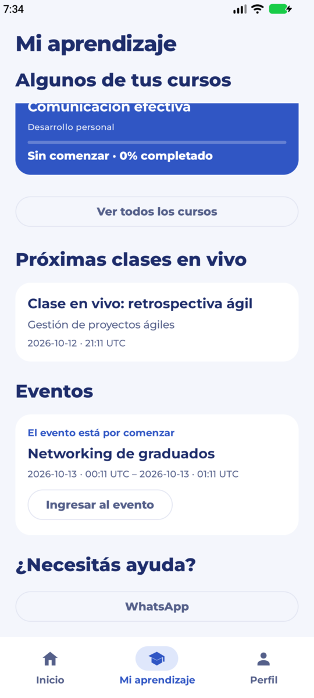
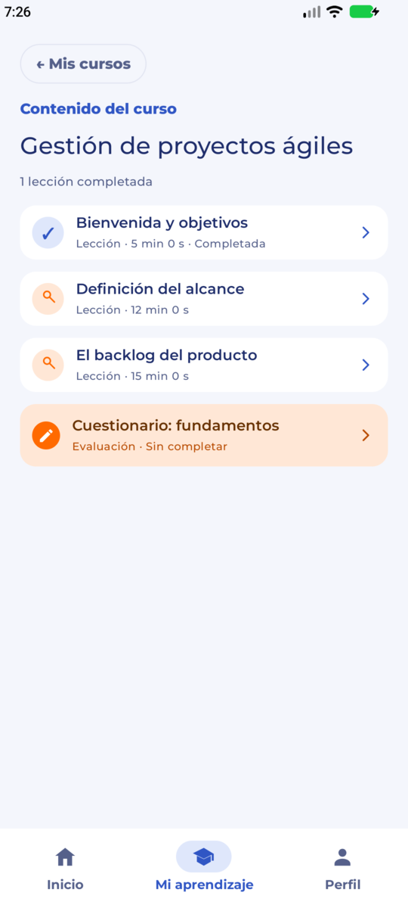
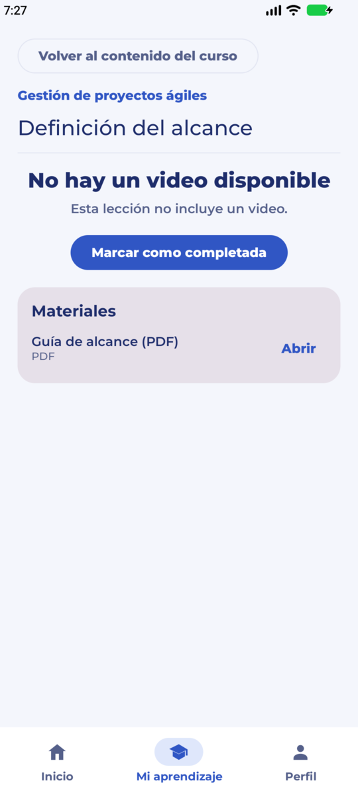
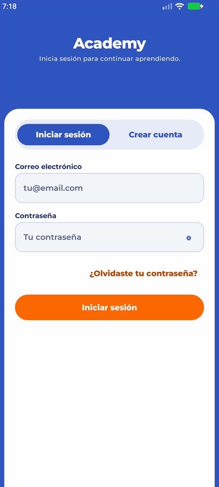
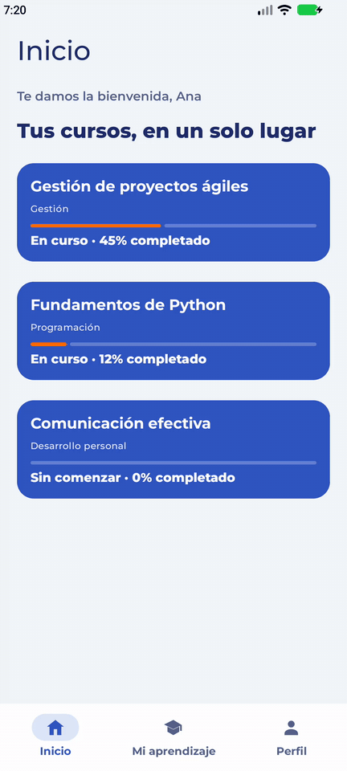
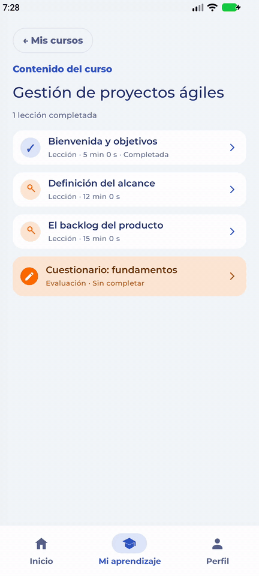

# Academy Client

**Kotlin Multiplatform mobile client (Android + iOS) for an online academy platform running on WordPress + LearnDash LMS.**

[](https://kotlinlang.org)
[](https://www.jetbrains.com/compose-multiplatform/)
[](https://ktor.io)
[]()
[](#testing)
[](https://github.com/Antunez-Thomas/academy-client/actions/workflows/ci.yml)

> **Client-only repository.** The WordPress plugin that exposes the curated REST API lives in a separate, private repository. Everything here is the mobile app: shared UI, networking, session, and platform integrations.

---

## Why this architecture

WordPress with LearnDash is a great LMS backend, but a mobile app must never talk to WordPress internals, themes, or plugin databases. The chosen design puts a **curated REST API boundary** between the two:

- The server owns everything platform-specific — course entitlements, LMS progression, community profiles, purchases, media authorization.
- The mobile client consumes **plain DTOs** and is completely agnostic about which plugin produced them. It has **zero references** to WordPress, LearnDash, WooCommerce, or any community plugin.
- Swapping or upgrading any server-side plugin requires no app change as long as the API contract holds.



Dashed links are **optional server-side integrations**: the client never sees them.

See [ARCHITECTURE.md](ARCHITECTURE.md) for the full design: layering, session lifecycle, and the complete API surface.

## Tech stack

| Layer | Choice |
| --- | --- |
| Language / targets | Kotlin 2.4.10 · `commonMain` + `androidMain` + `iosMain` (Android, `iosArm64`, `iosSimulatorArm64`) |
| UI | Compose Multiplatform 1.11.1 · Material 3 · shared `App()` for both platforms |
| Networking | Ktor 3.5.2 (Android & Darwin engines) · kotlinx-serialization |
| Session | Custom single-flight refresh-token rotation · `StateFlow` state machine |
| Secure storage | Android Keystore (AES-GCM) · iOS Keychain (device-only) |
| View models | `androidx.lifecycle` ViewModels in `commonMain` |
| Tests | `kotlin-test` · Ktor `MockEngine` · coroutines-test · Android instrumentation |
| Build | Gradle 9.3.1 (Kotlin DSL, version catalog) · JDK 21 · AGP 9.1.1 |

## Features

- **Authentication** — sign in, registration with legal-consent flow, password reset, session restore on cold start, expiry handling.
- **Token refresh** — single-flight rotation: N concurrent 401s trigger exactly **one** refresh call, the replacement pair is persisted *before* it is published, and the failed request is retried once. Covered by concurrency tests (12-way fan-out, logout-vs-refresh races).
- **Secure storage** — tokens encrypted with a non-exportable Keystore key on Android; Keychain with `AfterFirstUnlockThisDeviceOnly` accessibility on iOS.
- **Learning** — My Learning dashboard, entitled courses, curriculum tree, lesson/topic details, progress saves with idempotency keys, explicit lesson completion.
- **Video** — authorized hosted embed playback with strict HTTPS URL validation, main-frame navigation allowlisting, and full WebView teardown when the lesson closes.
- **Quizzes** — LearnDash-style quizzes rendered in an **isolated WebView session** (separate data store/profile), single-use launch tickets redeemed via form POST, and explicit logout cleanup of browsing data.
- **Account** — profile editing, avatar upload/remove, account-deletion request flow.
- **Design system** — color/spacing/dimension tokens, Montserrat typography scale, light & dark themes, adaptive shell (bottom bar → navigation rail at 600/840 dp), reading-width cap.
- **Localization** — all app copy in Latin American Spanish through shared Compose resources; server-authored content is never translated.

## Screenshots

<p align="center">
  
  
  
  
</p>

Full flows (recorded against a local demo backend with fake data):

| Sign in | Open a course | Complete a lesson |
| --- | --- | --- |
|  |  |  |

## API surface

The client defines one interface, `AcademyApi`, implemented by `KtorAcademyApi`. Base path `/wp-json/academy-mobile/v1/`:

| Method | Route | Purpose |
| --- | --- | --- |
| GET | `auth/options` | Registration options (e.g. whether legal consent is required) |
| POST | `auth/login` | Sign in → access/refresh token pair |
| POST | `auth/register` | Create account |
| POST | `auth/password-reset` | Request password reset |
| POST | `auth/refresh` | Rotate the token pair |
| POST | `auth/logout` | Revoke the session |
| GET | `me` | Current learner profile |
| POST | `me/profile` | Update first name / surname / phone |
| POST / DELETE | `me/avatar` | Upload / remove avatar |
| POST | `account/deletion-request` | Start account deletion |
| GET | `dashboard` | My Learning dashboard payload |
| GET | `courses` | Courses the learner is entitled to |
| GET | `courses/{id}` | Course detail |
| GET | `courses/{id}/content` | Curriculum tree (sections → steps) |
| GET | `courses/{id}/progress` | Course progress |
| GET | `lessons/{lessonId}?courseId={id}` | Lesson/topic detail |
| POST | `lessons/{lessonId}/progress` | Save progress / completion |
| POST | `video/playback` | Authorize video playback |
| POST | `quiz/web-launch` | Issue a single-use quiz launch ticket |
| GET | `entitlements` | Entitlements |

Authenticated calls go through `AcademySessionManager.executeAuthenticated { … }`, which owns refresh-and-retry. The transport is fully typed: `ApiResult<T>` with a sealed `AcademyApiError` tree (timeouts, no connection, HTTP status mapping, decoding failures).

## Repository layout

```text
androidApp/    Android application host (manifest, launcher, MainActivity)
iosApp/        SwiftUI host + Xcode project (thin wrapper around the shared UI)
shared/        All shared code
└── src/
    ├── commonMain/    UI, view models, API, session, design system
    ├── androidMain/   Keystore, Android engine, WebView actuals
    ├── iosMain/       Keychain, Darwin engine, WKWebView actuals
    ├── commonTest/    120 shared tests (MockEngine contract, session concurrency, VMs)
    ├── androidHostTest/  JVM/host tests + opt-in live integration test
    ├── androidDeviceTest/ instrumentation tests (Keystore, WebView)
    └── iosTest/       Keychain & environment tests (run on macOS)
scripts/       agent-check.sh — deterministic verification harness
```

## Testing

**137 tests** across four source sets:

- **API contract** — Ktor `MockEngine` fixtures assert exact request shape, response decoding, and HTTP→error mapping, including malformed bodies and timeout/offline cases.
- **Session concurrency** — concurrent refresh fan-out, rejected refresh → expired, transient failure keeps tokens, logout during refresh.
- **View models** — loading/empty/error/retry states, navigation, completion idempotency, quiz lifecycle, sign-out cleanup.
- **Platform** — Keystore round-trip, WebView profile isolation, environment selection.

```bash
# default harness: diff check + credential scan + shared Android-host tests
./scripts/agent-check.sh

# everything from Linux
./gradlew \
  :shared:testAndroidHostTest \
  :androidApp:assembleDebug \
  :shared:compileTestKotlinIosSimulatorArm64
```

An opt-in live integration test exercises a real server using environment variables (`ACADEMY_LIVE_TEST=1`, `ACADEMY_API_BASE_URL`, …) — credentials are never committed.

## Build & run

Requirements: **JDK 21**, **Android SDK 36**, and Xcode for iOS.

```bash
./gradlew :androidApp:assembleDebug      # APK in androidApp/build/outputs/apk/debug/
```

Open `iosApp/iosApp.xcodeproj` in Xcode to run on an iOS simulator.

### API environments

Selection lives in `AcademyApiEnvironment.kt`:

| Environment | Base URL | Status |
| --- | --- | --- |
| Android emulator | `http://10.0.2.2:8080/wp-json/academy-mobile/v1/` | Local development |
| iOS simulator | `http://127.0.0.1:8080/wp-json/academy-mobile/v1/` | Local development |
| Staging | `https://api.example.com/wp-json/academy-mobile/v1/` (placeholder) | Configurable |
| Production | — | **Disabled in code** until explicitly approved |

## Working with AI agents

This project was built with an agent-assisted workflow, and the guardrails are part of the repo:

- [`AGENTS.md`](AGENTS.md) — standing instructions for any agent: layering rules (portable logic in `commonMain`, UI never touches Ktor), security rules (tokens only through secure storage, never log credentials), copy rules (Latin American Spanish via shared resources), and the required verification step.
- [`scripts/agent-check.sh`](scripts/agent-check.sh) — deterministic gate run before every commit: whitespace/merge validation, a credential-pattern scan, and the shared test suite.
- The human reviews every change; agents inspect → implement → verify → report.

## What is not included

- The WordPress plugin / REST API implementation (private, separate repository).
- Real server credentials, staging hosts, and learner data — replaced with placeholders and local-only URLs.
- Production API configuration, which stays disabled in code by design.

## License

Published as a portfolio showcase. No open-source license is granted; all rights reserved.
